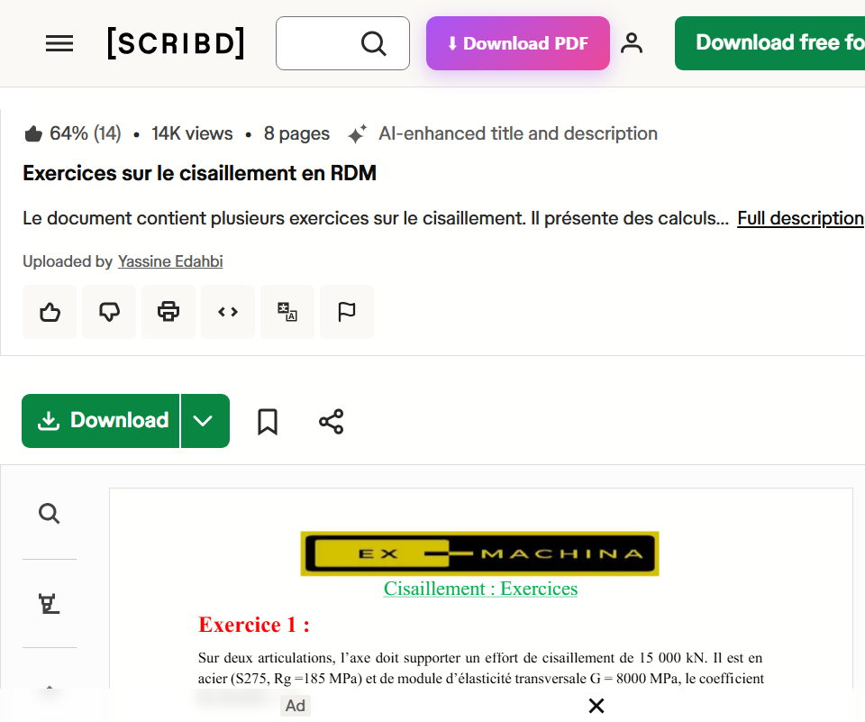
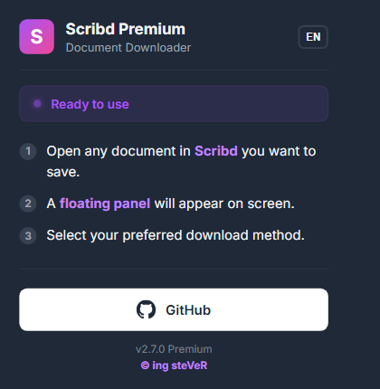
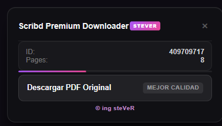

# Scribd Premium Downloader — steVeR Edition 🟣

> © **ing steVeR** — dérivé du projet open source original [Scribd-Downloader-Premium](https://github.com/HugoAleOlguin/Scribd-Downloader-Premium) en conservant intégralement sa logique, avec un habillage et des ajouts spécifiques.

Extension Chrome (Manifest V3) pour télécharger des documents **Scribd** en **PDF** via un service de téléchargement externe — en un seul clic.

---

## ✨ Ce qui distingue cette édition (steVeR Edition)

| Fonctionnalité | Détails |
|---|---|
| 🟣 **Thème steVeR** | Interface violette/fuchsia dans le panneau flottant et le popup, avec les crédits `© ing steVeR` |
| ⬇ **Bouton dans la barre Scribd** | Un bouton `⬇ Download PDF` apparaît dans l'en-tête (à côté de la recherche) sur les pages de documents |
| 🖱️ **Téléchargement en un clic** | Le bouton ouvre le lecteur embed et lance automatiquement le téléchargement externe |
| 🌐 **Anglais uniquement** | L'espagnol a été retiré ; toute l'interface est en anglais (EN) |
| 📥 **Une seule méthode** | Uniquement le téléchargement via site externe (les méthodes par capture d'écran ont été retirées) |

**Version :** 2.9.0 — `version_name : steVeR Edition`

---

## 🖼️ Aperçu (capture d'écran)

### 1. Bouton « ⬇ Download PDF » dans l'en-tête de Scribd


### 2. Popup de l'extension


### 3. Panneau flottant — le téléchargement externe (bouton unique)


---

## 📦 Installation

**Ne vous inquiétez pas — c'est plus simple qu'il n'y paraît ! Suivez simplement ces trois étapes.**

### Étape 1 — Télécharger l'extension

Cliquez sur le bouton ci-dessous pour télécharger la dernière version au format ZIP :

[](https://github.com/STEVERLAABS/Scribd-Downloader-steVeR/releases/latest)

*(ou via le bouton vert **Code** → **Download ZIP**)*

### Étape 2 — Activer le mode développeur et charger l'extension

1. Décompressez le ZIP dans un dossier de votre PC.
2. Ouvrez `chrome://extensions` dans Chrome.
3. Activez **Developer mode** (mode développeur) en haut à droite.
4. Cliquez **Load unpacked** et sélectionnez le dossier décompressé (celui qui contient `manifest.json`).
5. Vérifiez que l'extension est activée (interrupteur bleu).

### Étape 3 — Utiliser sur Scribd

Ouvrez un document Scribd (appuyez `F5` si la page était déjà ouverte) → le bouton **⬇ Download PDF** apparaît dans l'en-tête + le panneau flottant → **un clic suffit : la page bascule et le téléchargement du PDF démarre automatiquement.**

---

## 🧪 Installation détaillée (mode développeur)

### Étape par étape

1. **Téléchargez le projet** : cliquez sur le bouton vert **Code** en haut du dépôt → **Download ZIP** → décompressez dans un dossier de votre PC (par exemple le Bureau). *(Ou utilisez `git clone` si Git est installé.)*
2. **Ouvrez la page des extensions** : dans Chrome, tapez dans la barre d'adresse :

   ```
   chrome://extensions
   ```

3. **Activez le mode développeur** : l'interrupteur **Developer mode / Mode développeur** se trouve en haut à droite de la page — basculez-le sur **ON**. Sans cette étape, le bouton de chargement manuel n'apparaîtra pas.
4. **Chargez l'extension** : cliquez sur **Load unpacked / Charger l'extension non empaquetée** (apparaît après avoir activé le mode développeur) → sélectionnez le **dossier de l'extension** — le dossier qui contient le fichier `manifest.json`.
5. **Vérifiez l'activation** : la carte « Scribd Premium Downloader — steVeR Edition » apparaît dans la liste ; assurez-vous que son interrupteur est activé (bleu).
6. **Essayez** : ouvrez n'importe quel document Scribd et actualisez la page *(F5)* — vous verrez le bouton **⬇ Download PDF** en haut de la page + le panneau flottant.

### 🔄 Après une mise à jour du projet

Téléchargez la nouvelle version → remplacez les fichiers dans le même dossier → dans `chrome://extensions`, cliquez sur le bouton de **rechargement ↻ (Reload)** sur la carte de l'extension → actualisez la page Scribd.

### Résumé rapide

```
chrome://extensions  →  Developer mode : ON  →  Load unpacked  →  choisir le dossier  →  F5 sur Scribd
```

---

## 📖 Utilisation

1. Ouvrez un document Scribd → le bouton **⬇ Download PDF** apparaît dans la barre de Scribd + le panneau flottant en bas à droite de l'écran.
2. Cliquez sur **⬇ Download PDF** → la page bascule en mode lecteur et le **téléchargement externe démarre automatiquement** après une seconde — sans clic supplémentaire.
3. Suivez les étapes dans le nouvel onglet si elles apparaissent (la vérification automatique s'exécute seule) → le fichier PDF est enregistré dans votre dossier Téléchargements.

> Vous pouvez aussi cliquer directement sur le bouton **Descargar PDF Original** dans le panneau flottant.

---

## 🗂️ Structure du projet

```
Scribd-Downloader-steVeR/
├── manifest.json          # Configuration de l'extension (MV3) — steVeR Edition
├── background.js          # Service Worker : téléchargement externe + automatisation + notifications
├── content.js             # Logique de la page : panneau flottant + bouton d'en-tête + flux complet
├── overlay.css            # Thème steVeR (violet/fuchsia) du panneau flottant
├── popup.html / popup.js  # Fenêtre popup (EN) + bouton GitHub
├── libs/
│   ├── i18n.js            # Traductions (EN uniquement)
│   ├── shim.js
│   ├── html2canvas.min.js
│   └── jspdf.umd.min.js
└── icons/                 # Icônes de l'extension
```

---

## ⚠️ Notes

- Utilisation à des fins personnelles (sauvegarde de vos documents) — respectez les droits d'auteur des éditeurs.
- Tous les contrôles ont été validés : accolades/parenthèses équilibrées, UTF-8 sans BOM, `manifest.json` conforme.

---

## 📜 Crédits

- **Design, thème et droit** : © ing steVeR
- **Projet original** : [HugoAleOlguin/Scribd-Downloader-Premium](https://github.com/HugoAleOlguin/Scribd-Downloader-Premium) — merci pour ce travail open source.
